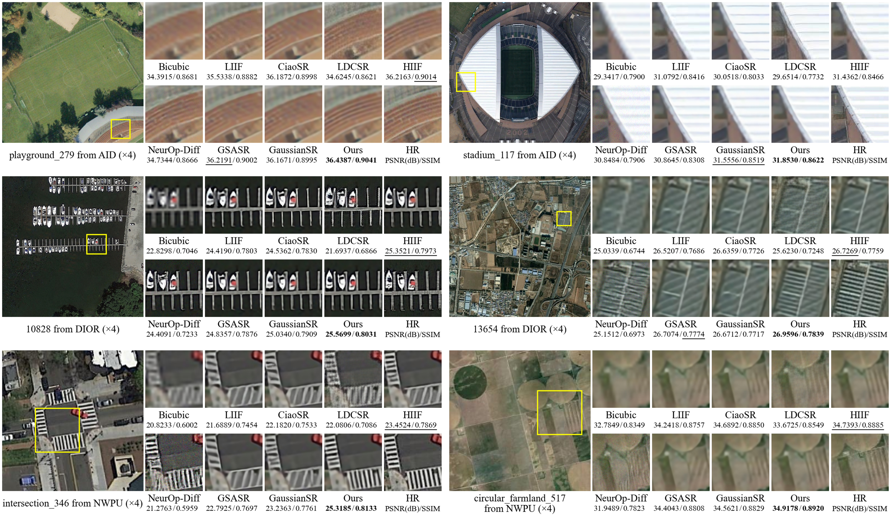

# NTAR-GS: Nonstationary Topological Prior-Conditioned Autoregressive Gaussian Splatting for Continuous-Scale Remote Sensing Image Super-Resolution

- Authors: Jiao Fu, Yuanping Xia<sup>&#42;</sup>, and Jing Chen<sup>&#42;</sup>
- East China University of Technology and Wuhan University

## Overview

We propose NTAR-GS, a novel model for continuous-scale remote sensing image super-resolution (SR) based on 2D Gaussian Splatting (2D GS). It unifies adaptation to spatial structures and cross-level generative dependencies within an explicit continuous Gaussian representation. The model uses a nonstationary topological prior (NTP) to constrain the organization of Gaussian primitives, recursively generates child Gaussians through parent-conditioned autoregressive Gaussian generation (PCAG), and incorporates hierarchical residual Gaussian Splatting (HRGS) to progressively recover local details by building on inherited structures. Experimental results show that NTAR-GS exhibits advantages over state-of-the-art SR methods in both quantitative evaluation and visual reconstruction quality, while demonstrating good generalization in scale extrapolation and real-world image tests. Compared with other SR methods based on Gaussian representations, the proposed model achieves an average PSNR gain exceeding 0.15 dB and an inference speedup of up to 23.78×.

<p align="center">
  
</p>

## Dependencies and Installation

- Python 3.9
- PyTorch 1.13.1 / torchvision 0.14.1
- CUDA 11.7
- BasicSR 1.3.4.9

Other dependencies:

```bash
pip install -r requirements.txt

git clone https://github.com/XingtongGe/gsplat.git
cd gsplat
git checkout bf697c8
pip install -e ".[dev]"
```

## Dataset Preparation

We use AID, DIOR, and NWPU-RESISC45 for simulated SR experiments, treating the original images as HR references and generating corresponding LR images through bicubic downsampling. UC Merced is used for real-world experiments, with the original images directly used as inputs without any simulated degradation. Download the original images from the official links below, or use your own images for inference.

| Dataset | Usage | Number of images |
| --- | --- | --- |
| [AID](https://captain-whu.github.io/AID/) | train / val / test | 8,000 / 1,000 / 1,000 |
| [DIOR](https://gcheng-nwpu.github.io/#Datasets) | cross-dataset test | 1,000 |
| [NWPU-RESISC45](https://gcheng-nwpu.github.io/#Datasets) | cross-dataset test | 900 |
| [UC Merced](https://vision.ucmerced.edu/datasets/) | Real-world no-reference evaluation | 420 |

## Usage
### Pretrained Model

Download the pretrained model [NTAR-GS.pth](https://pan.baidu.com/s/1gdT128vMcv8xtSJSA16pXA?pwd=68sc) and place it in the project root directory.

### Inference

Run the following command from the project root directory to perform super-resolution on a single image:

```bash
python inference.py --input examples/input/playground_279.png --model NTAR-GS.pth --scale 4 --output examples/output/playground_279_x4.png
```
### Test

Set the dataset and split file paths in `configs/test/test.yaml`, then run the following command from the project root directory. After testing, the average PSNR and SSIM on the Y channel will be printed in the terminal. For multi-scale evaluation, replace `--scales 4` with `--scales 2 2.75 3 8`.

```bash
# Test AID at x4
python test.py --config configs/test/test.yaml --model NTAR-GS.pth --scales 4
```

### Train

```bash
python train.py --config configs/train/train.yaml --name NTAR-GS-train
```

## Results
See this article for quantitative comparison and visualization results. Here are visual examples.
### Visual Examples
<p align="center">
  
</p>

## License

The original NTAR-GS source code is released under the [MIT License](LICENSE). 

## Acknowledgments

We thank the authors of [GaussianImage](https://github.com/XingtongGe/gsplat) and [GaussianSR](https://github.com/tljxyys/GaussianSR) for their excellent open-source contributions!


